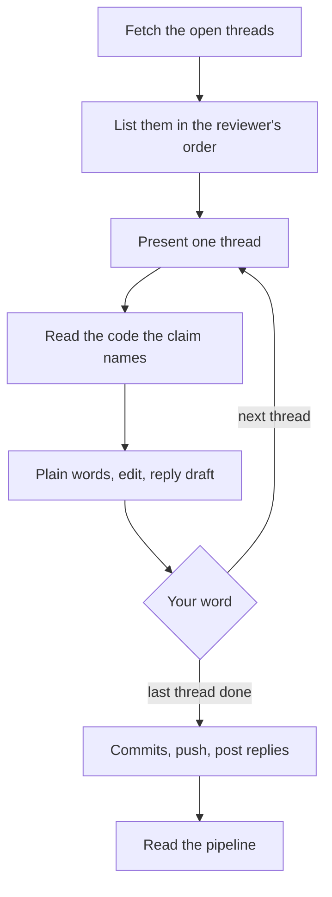

<div align="center">

<p align="center">
  
  &nbsp;&nbsp;&nbsp;
  <picture><source media="(prefers-color-scheme: dark)" srcset="assets/icons/openai-white.svg"></picture>
  &nbsp;&nbsp;&nbsp;
  
  &nbsp;&nbsp;&nbsp;
  <picture><source media="(prefers-color-scheme: dark)" srcset="assets/icons/githubcopilot-white.svg"></picture>
  &nbsp;&nbsp;&nbsp;
  <picture><source media="(prefers-color-scheme: dark)" srcset="assets/icons/cursor-white.svg"></picture>
  &nbsp;&nbsp;&nbsp;
  <picture><source media="(prefers-color-scheme: dark)" srcset="assets/icons/windsurf-white.svg"></picture>
  &nbsp;&nbsp;&nbsp;
  <picture><source media="(prefers-color-scheme: dark)" srcset="assets/icons/cline-white.svg"></picture>
</p>

# review-replies

**Answer review comments one thread at a time, checked against the code.**

An [Agent Skills](https://agentskills.io) skill: each claim read against the code, the exact edit,
and a reply drafted in your team's own register. You decide every edit, commit, and reply.

[![Validate][badge-validate]][link-validate]
[![Release][badge-release]][link-releases]
[![License][badge-license]](LICENSE)
[![Agent Skills][badge-agent-skills]](https://agentskills.io)

[![Claude Code][badge-claude-code]](#install)
[![Codex][badge-codex]](#install)
[![Gemini CLI][badge-gemini-cli]](#install)
[![GitHub Copilot][badge-github-copilot]](#install)
[![Cursor][badge-cursor]](#install)
[![Windsurf][badge-windsurf]](#install)
[![Cline][badge-cline]](#install)

</div>

## What it teaches your agent

| Rule | Why |
| --- | --- |
| **One thread at a time**, then wait for your word | Batching threads hides the decision on each one |
| **Read the line before agreeing**, the reviewer's suggested fix included | Reviewers misread code too, and a suggested fix can break the build |
| **Four parts per thread**: plain words, the exact edit, a reply draft, what your go-ahead applies | The whole decision fits on one screen |
| **Three short sentences** ending in a verdict: right, right but the fix breaks, or wrong | Anything past the claim is a tangent |
| **Replies in the team's own language and register**, with no verdict on the reviewer | The thread reads like a colleague, not a ruling |
| **Commit, push, and posting each wait for your word** | You own what ships under your name |

Threads come from GitHub through `gh` and from GitLab through `glab`.

## How it works



## Example

One thread, as the skill presents it:

> **Plain words.** The reviewer says the retry loop never stops on a 404.
> `src/http/retry.ts:31` retries every status from 400 up. Verdict: right.
>
> **Exact edit.** In `src/http/retry.ts:31`:
>
> ```ts
> if (response.status >= 500) {
> ```
>
> **Reply draft.** Right, it retried every 4xx as well. It now retries only on server errors:
>
> `src/http/retry.ts`
>
> **Go-ahead applies** the one-line change in `src/http/retry.ts:31`.

## Install

| Agent | Command |
| --- | --- |
| ![Claude Code][badge-claude-code] | `/plugin marketplace add ArefMozafari/review-replies`<br>`/plugin install review-replies@review-replies` |
| ![Gemini CLI][badge-gemini-cli] | `gemini extensions install https://github.com/ArefMozafari/review-replies` |
| ![GitHub Copilot CLI][badge-github-copilot-cli] | `copilot plugin marketplace add ArefMozafari/review-replies`<br>`copilot plugin install review-replies@review-replies` |
| ![Cursor][badge-cursor] | `agent plugin marketplace add https://github.com/ArefMozafari/review-replies`<br>then `/plugins` in `agent` and install `review-replies` |
| ![Codex][badge-codex] ![Cursor][badge-cursor] ![Windsurf][badge-windsurf] ![Cline][badge-cline] and more | `npx skills add ArefMozafari/review-replies` |
| ![GitHub CLI][badge-github-cli] for Copilot and other agents | `gh skill install ArefMozafari/review-replies` |

<details>
<summary><b>Manual install</b></summary>

<br>

Copy the `skills/review-replies` folder into your agent's skills directory:

| Agent | Directory |
| --- | --- |
| Claude Code | `~/.claude/skills/` |
| Codex, Gemini CLI, GitHub Copilot, Cursor, Windsurf, OpenCode, Goose, Amp | `~/.agents/skills/` |
| Cline | `~/.cline/skills/` |

</details>

<details>
<summary><b>Development</b></summary>

<br>

Every push is checked by [`.github/workflows/validate.yml`](.github/workflows/validate.yml).
To run the skill and Claude Code checks locally from the repository root:

```bash
uvx --from skills-ref==0.1.1 agentskills validate skills/review-replies
claude plugin validate --strict .claude-plugin/marketplace.json
claude plugin validate --strict .claude-plugin/plugin.json
```

The workflow also checks the Gemini manifest's fields and validates the Cursor manifests against
the JSON schemas Cursor publishes.

</details>

## More skills

- [pr-evidence](https://github.com/ArefMozafari/pr-evidence): make every pull request show its
  change, not describe it.
- [review-findings](https://github.com/ArefMozafari/review-findings): report every code review
  finding in one shape, ready to paste.
- [post-merge-cleanup](https://github.com/ArefMozafari/post-merge-cleanup): clean up branches,
  worktrees, and stale notes once a pull request has merged.

## License

MIT. See [LICENSE](LICENSE).

<!-- Badge images are defined once here and reused by the header and the install table. -->

[link-validate]: https://github.com/ArefMozafari/review-replies/actions/workflows/validate.yml
[link-releases]: https://github.com/ArefMozafari/review-replies/releases
[badge-validate]: https://github.com/ArefMozafari/review-replies/actions/workflows/validate.yml/badge.svg
[badge-release]: https://img.shields.io/github/v/release/ArefMozafari/review-replies
[badge-license]: https://img.shields.io/github/license/ArefMozafari/review-replies
[badge-agent-skills]: https://img.shields.io/badge/Agent_Skills-compatible-blue
[badge-claude-code]: https://img.shields.io/badge/Claude_Code-24292F?logo=claude&logoColor=white
[badge-gemini-cli]: https://img.shields.io/badge/Gemini_CLI-24292F?logo=googlegemini&logoColor=white
[badge-github-copilot]: https://img.shields.io/badge/GitHub_Copilot-24292F?logo=githubcopilot&logoColor=white
[badge-github-copilot-cli]: https://img.shields.io/badge/GitHub_Copilot_CLI-24292F?logo=githubcopilot&logoColor=white
[badge-cursor]: https://img.shields.io/badge/Cursor-24292F?logo=cursor&logoColor=white
[badge-windsurf]: https://img.shields.io/badge/Windsurf-24292F?logo=windsurf&logoColor=white
[badge-cline]: https://img.shields.io/badge/Cline-24292F?logo=cline&logoColor=white
[badge-github-cli]: https://img.shields.io/badge/GitHub_CLI-24292F?logo=github&logoColor=white

<!-- Shields.io's icon set has no OpenAI logo, so the Codex badge embeds the simple-icons SVG. -->

[badge-codex]: https://img.shields.io/badge/Codex-24292F?logo=data:image/svg%2bxml;base64,PHN2ZyBmaWxsPSJ3aGl0ZSIgcm9sZT0iaW1nIiB2aWV3Qm94PSIwIDAgMjQgMjQiIHhtbG5zPSJodHRwOi8vd3d3LnczLm9yZy8yMDAwL3N2ZyI+PHRpdGxlPk9wZW5BSTwvdGl0bGU+PHBhdGggZD0iTTIyLjI4MTkgOS44MjExYTUuOTg0NyA1Ljk4NDcgMCAwIDAtLjUxNTctNC45MTA4IDYuMDQ2MiA2LjA0NjIgMCAwIDAtNi41MDk4LTIuOUE2LjA2NTEgNi4wNjUxIDAgMCAwIDQuOTgwNyA0LjE4MThhNS45ODQ3IDUuOTg0NyAwIDAgMC0zLjk5NzcgMi45IDYuMDQ2MiA2LjA0NjIgMCAwIDAgLjc0MjcgNy4wOTY2IDUuOTggNS45OCAwIDAgMCAuNTExIDQuOTEwNyA2LjA1MSA2LjA1MSAwIDAgMCA2LjUxNDYgMi45MDAxQTUuOTg0NyA1Ljk4NDcgMCAwIDAgMTMuMjU5OSAyNGE2LjA1NTcgNi4wNTU3IDAgMCAwIDUuNzcxOC00LjIwNTggNS45ODk0IDUuOTg5NCAwIDAgMCAzLjk5NzctMi45MDAxIDYuMDU1NyA2LjA1NTcgMCAwIDAtLjc0NzUtNy4wNzI5em0tOS4wMjIgMTIuNjA4MWE0LjQ3NTUgNC40NzU1IDAgMCAxLTIuODc2NC0xLjA0MDhsLjE0MTktLjA4MDQgNC43NzgzLTIuNzU4MmEuNzk0OC43OTQ4IDAgMCAwIC4zOTI3LS42ODEzdi02LjczNjlsMi4wMiAxLjE2ODZhLjA3MS4wNzEgMCAwIDEgLjAzOC4wNTJ2NS41ODI2YTQuNTA0IDQuNTA0IDAgMCAxLTQuNDk0NSA0LjQ5NDR6bS05LjY2MDctNC4xMjU0YTQuNDcwOCA0LjQ3MDggMCAwIDEtLjUzNDYtMy4wMTM3bC4xNDIuMDg1MiA0Ljc4MyAyLjc1ODJhLjc3MTIuNzcxMiAwIDAgMCAuNzgwNiAwbDUuODQyOC0zLjM2ODV2Mi4zMzI0YS4wODA0LjA4MDQgMCAwIDEtLjAzMzIuMDYxNUw5Ljc0IDE5Ljk1MDJhNC40OTkyIDQuNDk5MiAwIDAgMS02LjE0MDgtMS42NDY0ek0yLjM0MDggNy44OTU2YTQuNDg1IDQuNDg1IDAgMCAxIDIuMzY1NS0xLjk3MjhWMTEuNmEuNzY2NC43NjY0IDAgMCAwIC4zODc5LjY3NjVsNS44MTQ0IDMuMzU0My0yLjAyMDEgMS4xNjg1YS4wNzU3LjA3NTcgMCAwIDEtLjA3MSAwbC00LjgzMDMtMi43ODY1QTQuNTA0IDQuNTA0IDAgMCAxIDIuMzQwOCA3Ljg3MnptMTYuNTk2MyAzLjg1NThMMTMuMTAzOCA4LjM2NCAxNS4xMTkyIDcuMmEuMDc1Ny4wNzU3IDAgMCAxIC4wNzEgMGw0LjgzMDMgMi43OTEzYTQuNDk0NCA0LjQ5NDQgMCAwIDEtLjY3NjUgOC4xMDQydi01LjY3NzJhLjc5Ljc5IDAgMCAwLS40MDctLjY2N3ptMi4wMTA3LTMuMDIzMWwtLjE0Mi0uMDg1Mi00Ljc3MzUtMi43ODE4YS43NzU5Ljc3NTkgMCAwIDAtLjc4NTQgMEw5LjQwOSA5LjIyOTdWNi44OTc0YS4wNjYyLjA2NjIgMCAwIDEgLjAyODQtLjA2MTVsNC44MzAzLTIuNzg2NmE0LjQ5OTIgNC40OTkyIDAgMCAxIDYuNjgwMiA0LjY2ek04LjMwNjUgMTIuODYzbC0yLjAyLTEuMTYzOGEuMDgwNC4wODA0IDAgMCAxLS4wMzgtLjA1NjdWNi4wNzQyYTQuNDk5MiA0LjQ5OTIgMCAwIDEgNy4zNzU3LTMuNDUzN2wtLjE0Mi4wODA1TDguNzA0IDUuNDU5YS43OTQ4Ljc5NDggMCAwIDAtLjM5MjcuNjgxM3ptMS4wOTc2LTIuMzY1NGwyLjYwMi0xLjQ5OTggMi42MDY5IDEuNDk5OHYyLjk5OTRsLTIuNTk3NCAxLjQ5OTctMi42MDY3LTEuNDk5N1oiLz48L3N2Zz4=
